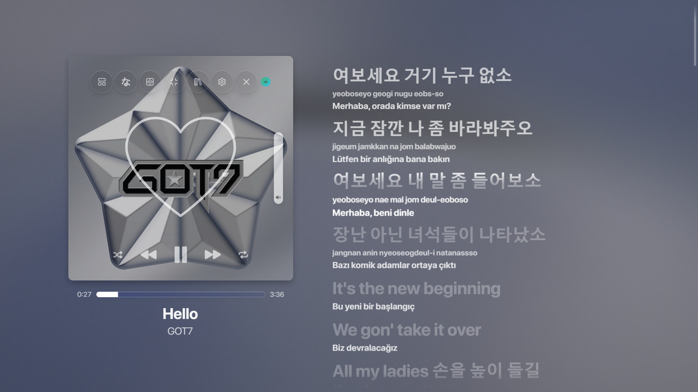

# 🔥 Spicy Lyrics AI Translator & Romaja (Spicetify Extension)

Simultaneous **Romanization (Romaja)** and **Context-Aware / Gemini AI Turkish Translations** right below your **Spicy Lyrics** lines — bringing the iconic *YouTube Music Better Lyrics* multi-line experience directly to Spotify Desktop!

Now available directly in **Spicetify Marketplace** ✅



## ✨ Features

* **Simultaneous Multi-Line Display:** Shows Original Lyrics (Hangul/Kanji/Thai/English) + **Romaja (Pronunciation)** + **Turkish Translation** all at once without replacing the original text.
* **Zero Blur & Crystal Clear UI:** Automatically removes Spicy Lyrics' heavy text-shadow blur on upcoming lines so subtitles are always crisp and readable.
* **Dual Translation Engine (GTX + Gemini AI):**
  * **Default Mode (`TR`):** Uses a context-aware sliding stanza neural translator (Google Translate) with zero setup required.
  * **AI Poetic Mode (`AI`):** Right-click the `TR` button in Spicy Lyrics controls to paste a free **Google Gemini API Key** (`aistudio.google.com/apikey`). Translates idioms, slang, and metaphors across the entire song with much higher accuracy, and matches the register (explicit stays explicit, playful stays playful) instead of a stiff dictionary translation.
* **Already-Turkish lines are skipped automatically** — a Turkish song won't get a pointless re-paraphrased "translation" rendered under its own lyrics.
* **Persistent Smart Cache:** Translated songs are saved locally (`localStorage`), meaning songs you replay load instantly and consume zero API quota — until you explicitly reset it (see below).

## 🚀 Installation

### Option 1 — Spicetify Marketplace (recommended)
1. Open **Spicetify Marketplace** inside Spotify.
2. Go to the **Extensions** tab and search for **"Spicy Lyrics AI Translator & Romaja"**.
3. Click **Install**. Spotify will restart automatically.
4. When a new version is published here, Marketplace will show an **Update available** badge on this card — just click it.

### Option 2 — Manual install
This is a companion extension that runs alongside **Spicy Lyrics**. Make sure you have Spicy Lyrics installed first!

1. Download `spicy-tr.js` from this repository.
2. Paste it into your Spicetify Extensions folder (`%appdata%\spicetify\Extensions` on Windows, `~/.config/spicetify/Extensions` on macOS/Linux).
3. Run the following commands in PowerShell / Terminal:
   ```powershell
   spicetify config extensions spicy-tr.js
   spicetify apply
   ```

## 🎮 How to Use

1. Make sure Spicy Lyrics is installed and its built-in **A (Romanization)** toggle is turned **OFF** (so original characters are visible).
2. **Left-click** the `TR` / `AI` button in the Spicy Lyrics control bar to toggle translations On/Off.
3. **Right-click** the `TR` / `AI` button to enter (or update) your free Gemini API key(s) — separate multiple keys with commas, **but only if they're from different Google accounts**, since each key has its own daily quota.
   * ⚠️ **Right-click + OK now fully resets the translation cache** so every visible line is re-translated from scratch using your current key(s). You'll get a confirmation prompt first, since this means real translation requests for every cached song. This is intentional — it's the only way to guarantee stale/bad cached lines (e.g. from before you added a key) actually get replaced.
4. If something still looks wrong after a reset, check the Spotify DevTools console (`Ctrl+Shift+I`) — look for `[SpicyTR V44]` log lines, which name exactly which engine (Gemini / Google Translate / MyMemory) handled a given line and why.

## 🛠 Troubleshooting

* **"My translations look broken/glued together" (e.g. words with no spaces):** This happened when the free Google Translate fallback (used automatically if Gemini isn't configured, or briefly rate-limited) returned malformed text, which then got cached permanently. As of v44, this is actively filtered out before caching, and right-click + OK will purge any old broken entries. If you still see this, right-click + OK to force a full retranslation.
* **"My Gemini keys don't seem to do anything":** Make sure each key is at least 10 characters and valid at `aistudio.google.com/apikey`. After entering them, confirm the reset prompt — this is required for existing cached lines to actually pick up the new key.
* **Nothing shows up at all:** Confirm Spicy Lyrics' own Romanization toggle is OFF, and that this extension is enabled in `spicetify config extensions` (or in Marketplace's Extensions tab).

## 📦 For Marketplace Updaters / Contributors

When pushing a new version of `spicy-tr.js`:
1. **Always bump the `"version"` field in `manifest.json`** — Marketplace compares the installed version against this field (or a GitHub release tag, if you publish one) to decide whether to show an "Update available" badge. If you forget to bump it, users' Marketplace cards won't show the update even though the code changed.
2. Keep the changelog comment block at the top of `spicy-tr.js` up to date — it's the fastest way for you (or anyone debugging an issue report) to see what changed between versions.
3. Optionally, cut a GitHub **Release** with a matching tag (e.g. `v44.0.0`) — this makes version detection more reliable across different Marketplace versions and gives users a changelog to read from the update dialog.
4. Commit and push to `main`. Marketplace fetches `manifest.json` live from the repo, so no separate submission step is needed for updates to an already-listed extension — only the *first* listing requires inclusion in the community catalog.

Developed with 💖 by [@korelili](https://github.com/korelili)
